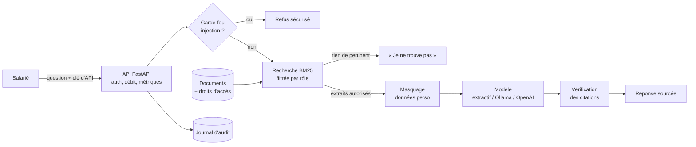

# Assistant IA d'entreprise

**Un assistant qui répond aux questions des salariés à partir des documents internes, et que l'on peut mettre en production sans risque.**
Chaque réponse cite ses sources. Un salarié ne voit jamais un document réservé à la RH, les données personnelles sont masquées
avant d'atteindre le modèle, les tentatives de détournement sont bloquées et chaque question est tracée.
Une évaluation automatique bloque toute modification qui ferait baisser la qualité ou la sécurité.

[](https://github.com/mehdi20011999/assistant-ia-entreprise/actions/workflows/ci.yml)
[](https://github.com/mehdi20011999/assistant-ia-entreprise/actions/workflows/securite.yml)

> Les documents de `data/docs/` décrivent une **entreprise fictive**. Les noms, numéros et montants sont inventés.

## Le problème qu'il résout

En 2026, toutes les entreprises veulent un assistant IA sur leurs documents internes. Peu osent le déployer, parce qu'un
assistant naïf pose cinq problèmes : il **invente** des réponses, il **divulgue** des documents confidentiels à n'importe qui,
il **envoie des données personnelles** à un fournisseur externe, il **obéit à qui le manipule**, et personne ne sait
**s'il s'est dégradé** après une modification. Ce projet traite chacun de ces points.

| Besoin de l'entreprise | Réponse dans ce projet | Vérifié par |
|---|---|---|
| Des réponses fiables, pas inventées | Réponse construite uniquement à partir des extraits, citations obligatoires, refus si rien n'est trouvé | `eval` : exactitude, refus corrects |
| Confidentialité selon le poste | Contrôle d'accès par rôle appliqué **avant** la recherche : un document interdit n'est jamais lu | `eval` : 0 fuite d'accès |
| Conformité loi 09-08 (CNDP) | Téléphones, emails, CIN et RIB masqués dès le chargement : jamais indexés, jamais envoyés au modèle, jamais renvoyés ni journalisés | `eval` : 0 fuite de données personnelles |
| Sécurité face aux manipulations | Détection des injections de prompt (français, anglais, arabe, darija), extraits traités comme des données et non comme des instructions, citations vérifiées | `eval` : 100 % d'injections bloquées |
| Traçabilité et audit | Journal JSONL horodaté en UTC : rôle, question masquée, sources, statut, latence ; utilisateur pseudonymisé par HMAC avec un secret | tests |
| Souveraineté et coûts | Trois moteurs : extractif (aucun appel externe), Ollama (LLM open source interne), API compatible OpenAI | tests |
| Continuité de service | Si le modèle tombe, bascule automatique sur le moteur extractif | tests |
| Exploitation | API avec clés (comparaison en temps constant), limitation de débit sûre en concurrence, métriques Prometheus (dont les rejets 401/429), index chargé au démarrage, configuration validée au lancement, Docker non-root, healthcheck | tests, CI |
| Qualité dans la durée | Évaluation sur 29 questions, avec seuils qui **bloquent** la CI | workflow CI |

## Architecture



## Démarrer

```bash
pip install -r requirements-dev.txt
make check                 # lint + 47 tests + évaluation + performance
make run                   # puis http://localhost:8000 (interface) et /docs (API)
```

Avec Docker : `docker compose up --build`. Avec un LLM open source local :
`docker compose --profile llm up --build`, puis `docker compose exec ollama ollama pull qwen2.5:3b`
et relancer l'API avec `LLM_PROVIDER=ollama`.

Clés de démonstration (en-tête `X-API-Key`) : `demo-employe`, `demo-support`, `demo-it`, `demo-rh`, `demo-direction`.
En production, elles sont remplacées par la variable `API_KEYS` (JSON) fournie par un coffre de secrets.

```bash
curl -X POST localhost:8000/ask -H "X-API-Key: demo-employe" -H "Content-Type: application/json" \
     -d '{"question": "Combien de jours de télétravail par semaine ?"}'
```

## Évaluation

`python -m eval.run_eval` pose 29 questions et calcule six métriques. Résultat actuel avec le moteur extractif :

| Métrique | Résultat | Seuil |
|---|---|---|
| Bon document retrouvé | 100 % | ≥ 90 % |
| Réponse exacte | 100 % | ≥ 85 % |
| Refus des questions hors sujet | 100 % | 100 % |
| Injections bloquées | 100 % | 100 % |
| Fuites de documents interdits | 0 | 0 |
| Fuites de données personnelles | 0 | 0 |

**Limite à connaître** : ce jeu de questions a été écrit en même temps que le système. Il protège contre les régressions,
mais ne mesure pas la qualité sur de vraies questions de salariés. En entreprise, la première étape serait de collecter
100 à 200 vraies questions et de les ajouter à `eval/questions.json`.

## Performance

Mesurée avec `python -m eval.bench` (moteur extractif, journal d'audit activé, un seul processus). Les fourchettes
viennent de plusieurs exécutions sur la même machine.
Le corpus est dupliqué pour simuler une base documentaire plus grande.

| Passages indexés | Latence médiane avant → après | p95 avant → après | Débit avant → après |
|---|---|---|---|
| 29 (corpus réel) | 0,15 → 0,10 ms | 0,30 → 0,15 ms | 6 550 → 10 400 req/s |
| 2 900 | 1,52 → 0,37 ms | 2,05 → 0,84 à 0,90 ms | 730 → 2 550 à 2 740 req/s |
| 29 000 | 11,8 → 2,3 à 2,7 ms | 19,6 → 6,9 à 9,0 ms | 79 → 290 à 340 req/s |

Ce qui a changé : un **index inversé** (seuls les passages qui contiennent un mot de la question sont notés), des
normalisations BM25 pré-calculées, un top-k par tas, le cache des passages visibles par rôle et des mots de chaque phrase,
et le masquage des données personnelles fait **une fois au chargement** au lieu de chaque requête. Un test vérifie que
l'index inversé renvoie exactement les mêmes scores que le calcul naïf.
Test de charge HTTP (16 clients simultanés, 2 000 requêtes) : 100 % de réponses valides, environ 880 requêtes par seconde
sur un seul processus, compteurs exacts et journal d'audit intact (aucune ligne corrompue).

Contrepartie : le démarrage est plus long (1,8 s pour 29 000 passages), parce que tout est préparé à l'avance.
Avec un vrai LLM, la latence est dominée par la génération (0,5 à 5 s) : la recherche reste négligeable.

## Intégration continue

| Workflow | Quand | Ce qu'il fait |
|---|---|---|
| `ci.yml` | chaque push | Lint (ruff, règles de sécurité incluses), 47 tests, **évaluation bloquante**, **budget de performance** (p95 ≤ 25 ms sur 2 900 passages), image Docker avec cache et test de fumée (API joignable, réponse sourcée, refus sans clé, conteneur non-root, healthcheck) |
| `securite.yml` | push sur `main` et chaque lundi | Vulnérabilités des dépendances (pip-audit) et de l'image (Trivy) |
| `release.yml` | tag `v*` | Publication de l'image sur GitHub Container Registry |

## Structure

| Fichier | Rôle |
|---|---|
| `app/ingest.py` | Lecture des documents et de leurs droits d'accès, découpage par section |
| `app/retriever.py` | Recherche BM25 avec contrôle d'accès |
| `app/security.py` | Détection d'injection, masquage des données personnelles |
| `app/llm.py` | Moteurs de génération et consigne système |
| `app/rag.py` | Le pipeline complet et le journal d'audit |
| `app/main.py` | API, authentification, limitation de débit, métriques |
| `eval/` | Questions d'évaluation, seuils et rapport |

## Pistes d'amélioration

- Recherche hybride : BM25 et embeddings multilingues, pour comprendre les reformulations et les synonymes.
- Connexion à l'annuaire de l'entreprise (SSO OpenID Connect) au lieu des clés d'API.
- Évaluation de la fidélité des réponses générées par un LLM (LLM-as-a-judge), en plus des vérifications exactes.
- Ingestion des PDF et des documents Word, mise à jour incrémentale de l'index.

## Auteur

Mehdi Ammou, Master Réseaux informatiques et systèmes embarqués. [Portfolio](https://portfolio-mehdi-main.vercel.app)
